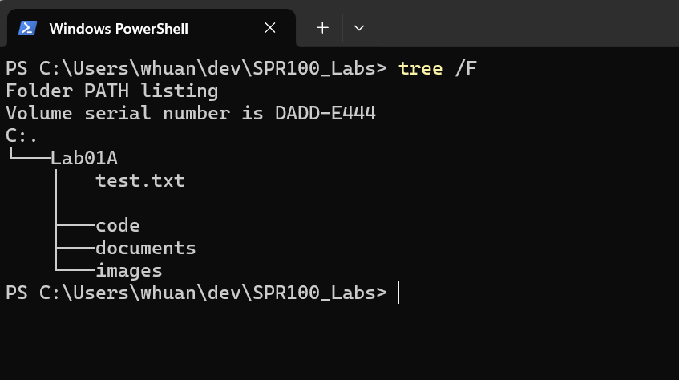
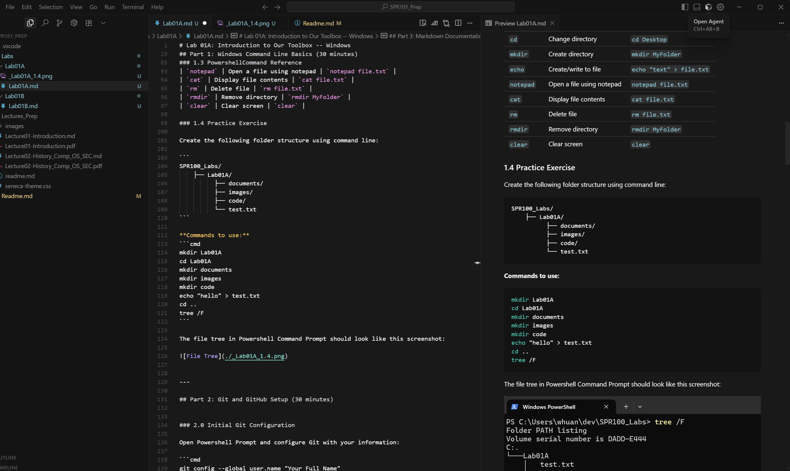

# Lab 01A: Introduction to Our Toolbox -- Windows

**Course:** SPR100 - Introduction to Computer Systems and Security  
**Duration:** 1 hour and 45 minutes  
**Due Date:** 23:59, September 14, 2025
**Weight:** 1% of final grade

---

## Learning Objectives

By the end of this lab, you will be able to:

1. **Navigate and use basic Windows shell commands** on a lab computer
2. **Create and format documentation** using Markdown syntax
3. **Submit lab assignments** using Git and GitHub
4. **Understand the course assessment structure** and submission process

---

## Pre-Lab Requirements

- **Windows 10/11** (Lab computers or your own laptop)
- **Git for Windows** (Download from: https://git-scm.com/download/win)
- **GitHub Account** (Login with your Seneca account at: https://github.com/Seneca-Polytechnic)

---

## Part 0: Windows Environment Setup

You have two options to setup your Windows environment:
- Option 1: Use the same Windows VM as you used in OPS110 (Recommended) and use your own SSD to load it on Security Lab computer.
- Option 2: Bring your own laptop, and:
  - You can use the Windows environment if you have a Windows 10/11 installed on your laptop.
  - You can also use a Virtual Machine Monitor (e.g., VMWare or VirtualBox) and reuse your Windows VM from OPS110.

---
## Part 1: Windows Command Line Basics (30 minutes)

### 1.1 Opening Powershell Command Prompt

1. **Method 1:** Press `Windows + R`, type `powershell`, press Enter
2. **Method 2:** Search for "Powershell" in Start menu
3. **Method 3:** Right-click Start button → Powershell

### 1.2 Essential Commands

Practice these commands in order, you will follow your instruction in class to practice these commands:

```cmd
# Check current directory using list command: ls
ls

# Change directory to Desktop (replace your own directory name with [Your Directory Name])
cd C:\Users\[Your Directory Name]\Desktop

# Create a new folder for your lab work
mkdir SPR100_Labs

# Navigate into the folder you just created
cd SPR100_Labs

# List contents (should be empty)
ls

# Create a new folder for your lab01A work
mkdir Lab01A

# Navigate into the lab01A folder
cd Lab01A

# Create a test file
echo "Hello World" > test.txt

# View file contents with notepad
notepad test.txt

# After closing the notepad, get back to powershell command prompt and check the file contents in command line with cat:
cat test.txt

# Go back one directory level
cd ..

# Go back one more directory level
cd ..

# check current directory
pwd

# list the file tree for the current directory
tree /F
```

### 1.3 PowershellCommand Reference
This is a reference for the commands you can use in Powershell Command Prompt. More detailed reference of Powershell commands can be found in [Windows Command Reference](https://docs.microsoft.com/en-us/windows-server/administration/windows-commands/windows-commands)

| Command | Purpose | Example |
|---------|---------|---------|
| `dir` | List files and folders | `dir` |
| `cd` | Change directory | `cd Desktop` |
| `mkdir` | Create directory | `mkdir MyFolder` |
| `echo` | Create/write to file | `echo "text" > file.txt` |
| `notepad` | Open a file using notepad | `notepad file.txt` |
| `cat` | Display file contents | `cat file.txt` |
| `rm` | Delete file | `rm file.txt` |
| `rmdir` | Remove directory | `rmdir MyFolder` |
| `clear` | Clear screen | `clear` |

### 1.4 Practice Exercise

Create the following folder structure using command line:

```
SPR100_Labs/
    ├── Lab01A/
          ├── documents/
          ├── images/
          ├── code/
          └── test.txt
```

**Commands to use:**
```cmd
mkdir Lab01A
cd Lab01A
mkdir documents
mkdir images
mkdir code
echo "hello" > test.txt
cd ..
tree /F
```

The file tree in Powershell Command Prompt should look like this screenshot:


(Your root folder names (C:\Users\...) might be different, but the structure should be the same.)

---

## Part 2: Git and GitHub Setup (30 minutes)


### 2.0 Initial Git Configuration

Open Powershell Prompt and configure Git with your information. Replace `[Your Full Name]` and `[youremail@myseneca.ca]` with your own information (DON'T just copy and paste the following commands!):

```cmd
git config --global user.name "[Your Full Name]"
git config --global user.email "[youremail@myseneca.ca]"
```

### 2.1 Create a GitHub Repository on GitHub Website
1. Go to [https://github.com/Seneca-Polytechnic](https://github.com/Seneca-Polytechnic) and sign in with your Seneca account.
2. Click your own profile icon in the top right corner and select "Your repositories".
3. Click the green "New" button.
4. Enter the repository name as `SPR100_Labs` and click "Create repository".


### 2.2 Connecting Local Folder to GitHub

Now, follow the steps on the GitHub website to connect your local folder to GitHub. In your PowershellCommand Prompt, navigate to your lab folder and run:

```cmd
# Navigate to your lab folder
cd C:\Users\[Your Directory Name]\Desktop\SPR100_Labs\

# Initialize Git repository
git init

# Add all files to staging
git add .

# Make your first commit
git commit -am "Initial commit: Lab 01 setup"

# Set main branch:
git branch -M main

# Add GitHub as remote origin (replace with your repository URL)
git remote add origin https://github.com/[YourUsername]/SPR100_Labs.git

# Push to GitHub
git push -u origin main
```

### 2.4 Git Workflow for Future Labs

For the future labs, you can use the following commands to commit and push your changes to GitHub:

```cmd
# Check status of your files
git status

# Add new or modified files
git add .

# Commit changes with descriptive message
git commit -am "Add lab documentation and exercises"

# Push to GitHub
git push
```

### 2.5 Common Git Commands

| Command | Purpose | Example |
|---------|---------|---------|
| `git status` | Check repository status | `git status` |
| `git add` | Stage files for commit | `git add .` |
| `git commit` | Commit staged changes | `git commit -m "message"` |
| `git push` | Upload to GitHub | `git push` |
| `git pull` | Download from GitHub | `git pull` |
| `git log` | View commit history | `git log` |


---

## Part 3: Markdown Documentation (45 minutes)

### 3.1 What is Markdown?

Markdown is a lightweight markup language used for:
- Documentation, including README files
- Technical writing, including code documentation, technical reports, and project documentation etc.
- Personal Note-taking
- AI training datasets
- AI-generated content

### 3.2 Create a README.md file

Create a new file called `README.md` in your lab folder using notepad:

```cmd
cd C:\Users\[Your Directory Name]\Desktop\SPR100_Labs\Lab01A
notepad README.md
```

Alternatively, you can use [VScode](https://code.visualstudio.com/) to create and view the files, which has a built-in markdown editor and real-timepreviewer. 

Examples of local settings for VScode will be shown in class, and here is a screenshot of the view of editting using VScode:


### 3.3 Basic Markdown Syntax

Use either notepad or VScode to practice these elements. 

If you use notepad, you can save the readme.md file and push it to GitHub using the following commands (In your previous local git repository folder):

```cmd
git add .
git commit -am "Add README.md"
git push
```

If you use VScode, you can edit the readme.md and at the same time preview the changes in the right side of the window. 

For pracicing Markdown syntax, you can use the following examples:

#### Headers
```markdown
# Main Title (H1)
## Section Title (H2)
### Subsection (H3)
#### Sub-subsection (H4)
```

#### Text Formatting
```markdown
**Bold text**
*Italic text*
***Bold and italic***
`inline code`
~~strikethrough~~
```

#### Lists
```markdown
# Unordered list
- Item 1
- Item 2
  - Sub-item 2.1
  - Sub-item 2.2
- Item 3

# Ordered list
1. First step
2. Second step
3. Third step
```

#### Links and Images
```markdown
[Link text](https://www.example.com)

```

#### Code Blocks
```markdown
# Inline code
Use `git status` to check repository status.

# Code block
```bash
git add .
git commit -m "Initial commit"
git push origin main
```


### 3.3 Your First Markdown Document

Create a comprehensive `README.md` file for your lab folder. You may copy&paste the following markdown code to your readme.md file, and update the `reflection` section:

```markdown
# SPR100 Lab01 - Introduction to Our Toolbox

**Student Name:** [Your Name]  
**Student ID:** [Your ID]  
**Date:** [Today's Date]

## Lab Overview

This lab introduces the essential tools and concepts for computer systems and security coursework.

## Learning Objectives

- [x] Navigate Windows command line
- [x] Create and format Markdown documentation
- [x] Use Git and GitHub for assignment submission
- [x] Understand course assessment structure

## Tools Covered

### 1. Windows Command Line
- Basic navigation commands (`dir`, `cd`, `mkdir`)
- File operations (`echo`, `type`, `del`)
- Directory management

### 2. Markdown Documentation
- Headers and text formatting
- Lists and links
- Code blocks and inline code
- Professional documentation practices

### 3. Git and GitHub
- Repository creation and management
- File version control
- Assignment submission workflow

## Folder Structure

SPR100_Labs/
├── README.md          # This file
├── documents/         # Documentation folder
├── images/           # Image assets folder
└── code/             # Code examples folder

## Reflection

[Write 2-3 sentences about what you learned and any challenges you faced]
```


## Resources

- [Markdown Guide](https://www.markdownguide.org/)
- [Git Documentation](https://git-scm.com/doc)
- [Windows Command Reference](https://docs.microsoft.com/en-us/windows-server/administration/windows-commands/windows-commands)


---

## Submission Instructions

### 4.1 What to Submit

1. **GitHub Repository URL** - Submit the link to your repository
2. **README.md File** - Ensure it's complete and well-formatted
3. **Folder Structure** - Verify all required folders exist

### 4.2 Submission Format

Submit via GitHub:

```
Repository URL: https://github.com/[YourSenecaUsername_Seneca]/SPR100_Labs

The readme.md file should include the following information:
- Student Name: [Your Full Name]
- Student ID: [Your Student ID]
- Lab Number: Lab01A
- Completion Date: [Date]
```

Here is a sample of the submitted `readme.md` file:
```markdown
# SPR100 Lab01 - Introduction to Our Toolbox

**Student Name:** John Doe
**Student ID:** 1234567 
**Lab Number:** Lab01A
**Completion Date:** 2025-09-08
```


The folder structure in your GitHub repository should be like this:
```
SPR100_Labs/
├── Lab01A/
│   ├── readme.md
│   ├── documents/
│   ├── images/
│   └── code/
└── [... Other lab folders, if any]
```

### 4.3 Due Date and Late Policy

- **Due Date:** [mentioned previously]
- **Late Submissions:** 10% penalty per day, up to 3 days
- **Extensions:** Must be requested via email to your instructor 24 hours before due date

---

## Additional Resources

### Documentation
- [Markdown Guide](https://www.markdownguide.org/)
- [Git Documentation](https://git-scm.com/doc)
- [GitHub Guides](https://guides.github.com/)

### Practice Exercises
- [Command Line Challenge](https://cmdchallenge.com/)
- [Markdown Practice](https://www.markdowntutorial.com/)
- [GitHub Skills](https://skills.github.com/)

---

## Next Steps

After completing this lab, you should:

1. **Practice regularly** with command line operations
2. **Continue learning** Markdown for documentation
3. **Familiarize yourself** with Git workflow
4. **Prepare for Lab 02** by reviewing course materials


