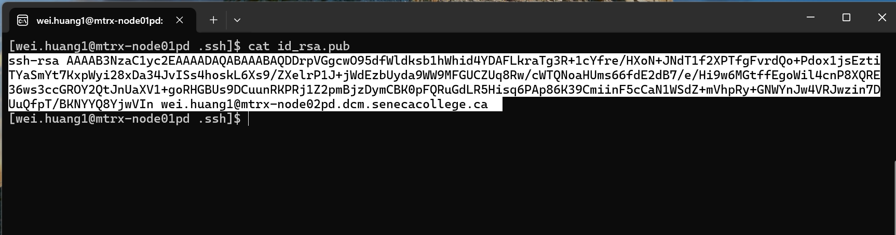
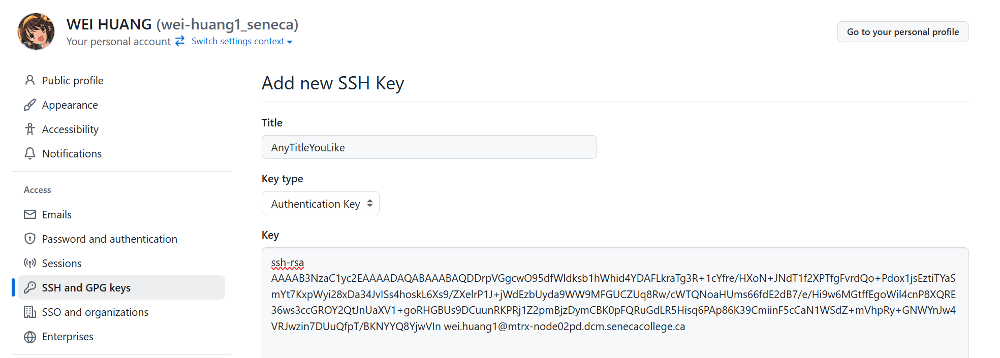
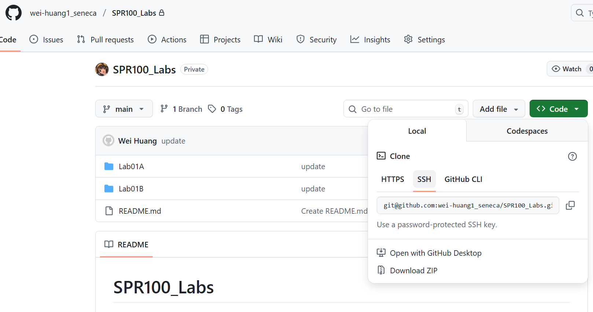
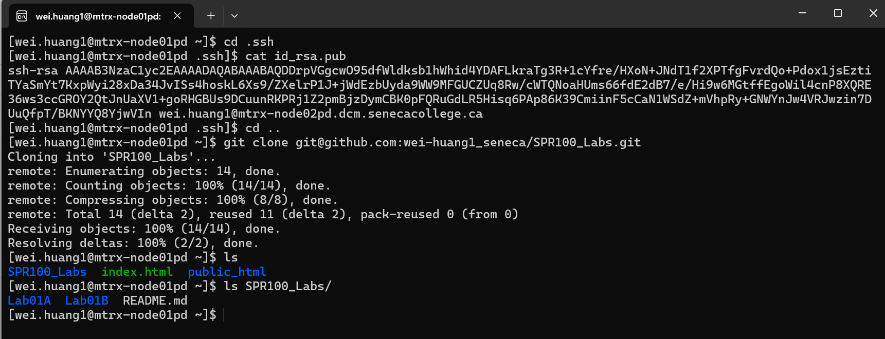

# Git SSH Setup

## 1. Generate SSH Key

In your matrix terminal (or your local linux terminal), run the following command to generate an SSH key:

```bash
ssh-keygen
```

This command will prompt you to enter a passphrase. You can leave it blank by pressing Enter.

After that, it generates two files: `id_rsa` and `id_rsa.pub` under your directory `~/.ssh/`. You can go to the directory `~/.ssh/` and check the two files. The `id_rsa.pub` file is your public key, and the `id_rsa` file is your private key.

## 2. Copy Public Key
Print your public key to the terminal:
```bash
cat ~/.ssh/id_rsa.pub
```
Select and copy the public key to your clipboard:



## 2. Add SSH Key to GitHub

Open your web browser and go to GitHub Settings:
- Click on your profile picture in the top right corner 
- Select "`Settings`"
- Select "`SSH and GPG keys`"
- Click on the green"New SSH key" button
- In `Title`, enter any title you want, it is just for your own reference
- In `Key`, paste your public key you copied from the previous step from Matrix terminal.

It will look like this on your GitHub webpage:

- Click Add SSH key.


## 3. Operate on your Git repository with SSH

Go back to your repository on GitHub, and click on the `Code` button, and copy the SSH URL. It will look like this:


Then, in your matrix terminal, run the following command to clone your repository with SSH:
```bash
cd ~
git clone [your-ssh-url]
```
It should look like this:


Now you can operate on your repository with SSH.


