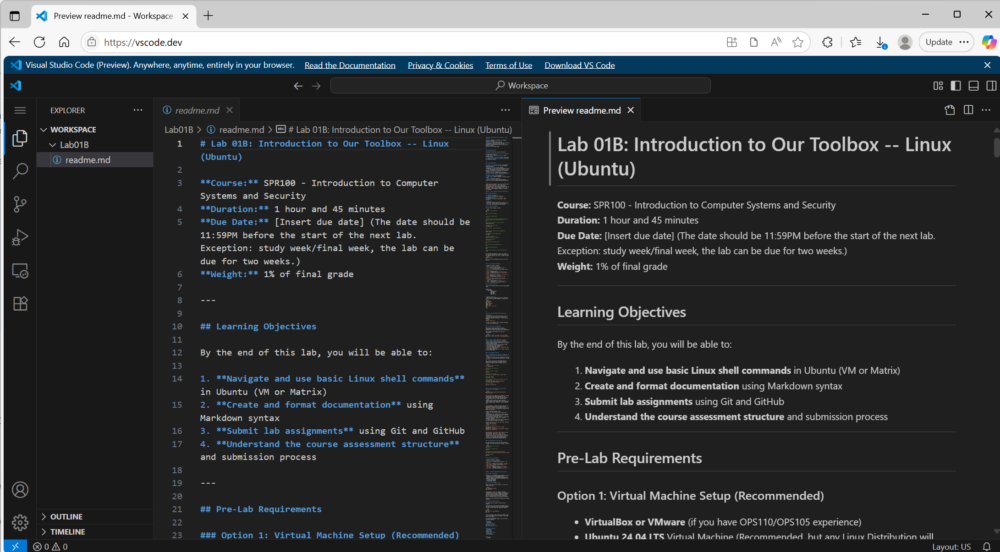

# Lab 01B: Introduction to Our Toolbox — Linux (Ubuntu)

**Course:** SPR100 — Introduction to Computer Systems and Security  
**Duration:** 1 hour 45 minutes  
**Due Date:** 2026-01-21 23:59  
**Weight:** 1% of final grade

---

## Learning Objectives

By the end of this lab, you can:

1. Use essential Linux shell commands (Ubuntu VM or Matrix)
2. Create clean documentation using Markdown
3. Submit work using Git and GitHub
4. Follow the course submission process

---

## Pre‑Lab Checklist

You may work on either an Ubuntu VM or the Matrix server.

### Option A — Ubuntu VM (recommended)
- VirtualBox or VMware
- Ubuntu 24.04 LTS
- Git installed: `sudo apt update && sudo apt install -y git`

### Option B — Matrix server (alternative)
- Matrix account (from OPS105)
- SSH client (PuTTY on Windows; Terminal on macOS/Linux)
- Connect with: `ssh [your-MySeneca-username]@matrix.senecapolytechnic.ca`
- Git available on Matrix

Note: Bracketed text like `[Your Name]` or `[Your Username]` is a placeholder—replace it with your actual value. Do not include the brackets.

---

## Part 1 — Linux Command Line Basics (25 minutes)

### 1.1 Open a terminal
- Ubuntu VM: press `Ctrl+Alt+T`, or search “Terminal” in Applications.
- Matrix: from your local terminal (e.g. Windows Powershell), run `ssh [username]@matrix.senecapolytechnic.ca` and log in.

### 1.2 Create your lab folders and a test file
Run these commands exactly, in order. Read comments carefully.

```bash
# Confirm where you are
pwd

# Go to your home directory
cd ~

# Create your course repo root folder
mkdir -p SPR100_Labs
cd SPR100_Labs

# Create today’s lab folder and enter it
mkdir -p Lab01B
cd Lab01B

# Create a test file and view it
echo "Hello SPR100" > test.txt
cat test.txt

# Optional: list the tree (install if needed, with $sudo apt install -y tree)
tree || ls -R
```

Tip (Ubuntu desktop only): You can edit files graphically, for example: `gedit test.txt` or use VS Code.

### 1.3 Command reference (quick)
| Command | Purpose | Example |
|---|---|---|
| `pwd` | Show current directory | `pwd` |
| `ls`, `ls -la` | List directory contents | `ls -la` |
| `cd` | Change directory | `cd ~/SPR100_Labs` |
| `mkdir -p` | Make directory | `mkdir -p Lab01B` |
| `echo >` | Create/write file | `echo "hi" > file.txt` |
| `cat` | Read a file | `cat file.txt` |
| `rm`, `rm -r` | Remove file/dir | `rm file.txt`, `rm -r folder` |
| `nano` | Terminal editor | `nano README.md` |

### 1.4 Practice: build this structure

Expected layout (under your home directory):

```
SPR100_Labs/
└── Lab01B/
    ├── README.md        # You will create in Part 3
    ├── documents/
    ├── images/
    └── code/
```

`(HINT:)` This is the expected layout of your lab folder for both your local environment and the one uploaded to GitHub. Files can be created under each folder, to make sure Gits accept the folder structure. 

Commands you can use:
```bash
cd ~/SPR100_Labs/Lab01B
mkdir -p documents images code
```

Verify:
```bash
tree || ls -R
```

---

## Part 2 — Git and GitHub Setup (35 minutes)

We will initialize a local Git repository, create a GitHub repository, and push your work.

### 2.1 Install/check Git and set identity
Ubuntu VM only (Matrix already has Git):
```bash
sudo apt update && sudo apt install -y git
```
Configure your name and email once on the machine (replace placeholders):
```bash
git config --global user.name "[Your Full Name]"
git config --global user.email "[yourname]@myseneca.ca"
git config --global init.defaultBranch main
```

### 2.2 Create the GitHub repository
1. Go to https://github.com/Seneca-Polytechnic and sign in with MySeneca.
2. Click your profile → “Your repositories” → “New”.
3. Repository name: `SPR100_Labs` → Create repository.
4. On the repo page, add your instructor as a collaborator (Settings → Collaborators and access → Add collaborator). Your instructor will provide the username.

### 2.3 Initialize and make your first push
Run these from your Linux terminal in your course folder:
```bash
cd ~/SPR100_Labs
git init
git add .
git commit -m "Initial commit: Lab01B setup"
git branch -M main

# Replace the URL with your actual GitHub repo URL
git remote add origin https://github.com/[YourGitHubUsername]/SPR100_Labs.git
git push -u origin main
```

If prompted for authentication, follow the GitHub instructions (browser sign-in or token).

If you see an HTTPS authentication error on Linux like:
```
remote: Invalid username or token. Password authentication is not supported for Git operations.
```
Use a Personal Access Token (PAT) as your password (GitHub → Settings → Developer settings → Personal access tokens → Tokens (classic) → Generate new token with repo scope). Or use SSH keys.

### 2.4 Daily workflow (for future changes)
```bash
git status
git add .
git commit -m "Describe what changed"
git push
```

Common commands: `git pull`, `git log`.

---

## Part 3 — Markdown Documentation (35 minutes)

### 3.1 Create `README.md`
Use `nano` to create and edit the `README.md` file:

- Nano (terminal editor):
  ```bash
  cd ~/SPR100_Labs/Lab01B
  nano README.md
  ```
  Save with Ctrl+O, Enter; exit with Ctrl+X.

**If you have your favorite editor, you can choose to use it instead of `nano`. The instructor in the lab session may not have enough time to support you with the following alternatives, but you can try them on your own:**

- VS Code (desktop): best experience with live Markdown preview.
  - Open a terminal and run:
    ```bash
    cd ~/SPR100_Labs/Lab01B
    code .               # opens the folder in VS Code
    ```
  - Create `README.md` and preview with “Markdown: Open Preview to the Side”
    (Ctrl+K V on Windows/Linux; Cmd+K V on macOS).
- VS Code in the browser: https://vscode.dev/
  - Works similarly to desktop for Markdown editing and preview.
  - Open the folder or file, then use the Markdown preview as above.
  - Screenshot:    
    
- Gedit (Ubuntu desktop):
  ```bash
  gedit ~/SPR100_Labs/Lab01B/README.md
  ```
  Note: Matrix has no GUI, so use nano there.

### 3.2 Basic Markdown to practice
```markdown
# Title (H1)
## Section (H2)
### Subsection (H3)

**bold** *italic* `code` ~~strikethrough~~

- Unordered item
  - Sub item
1. Ordered step
2. Next step

[A link](https://example.com)
```

### 3.3 Fill this template in your README.md
Replace placeholders with your information and complete the Reflection.

```markdown
# SPR100 Lab01B — Introduction to Our Toolbox (Linux)

**Student Name:** [Your Name]  
**Student ID:** [Your ID]  
**Completion Date:** [YYYY-MM-DD]

## Lab Overview
This lab practices core Linux commands, Markdown documentation, and Git/GitHub submission workflow using Ubuntu or the Matrix server.

## Learning Objectives
- [x] Navigate the Linux command line
- [x] Create and format Markdown documentation
- [x] Use Git and GitHub for submission
- [x] Follow the course submission process

## Tools Covered
- Linux shell: `pwd`, `ls`, `cd`, `mkdir`, `echo`, `cat`, `nano`
- Markdown basics: headings, emphasis, lists, links, code
- Git/GitHub: init, add, commit, push

## Folder Structure
SPR100_Labs/
└── Lab01B/
    ├── README.md
    ├── documents/
    ├── images/
    └── code/

## Reflection
[Write 2–4 sentences about what you learned, what worked well, and one challenge you faced.]
```

### 3.4 Commit and push your README
```bash
cd ~/SPR100_Labs
git add .
git commit -m "Add Lab01B README and folders"
git push
```

---

## Submission

### What to submit
- GitHub repository URL: `https://github.com/[YourGitHubUsername]/SPR100_Labs`
- Completed `README.md` in `Lab01B/`
- Folder structure created as shown

### Submission notes
- Your README.md must include: Student Name, Student ID, Lab Number (Lab01B), Completion Date, and the Reflection section.
- Ensure your latest changes are pushed to GitHub before the deadline.

### Due date and late policy
- Due: [Insert date/time]
- Late submissions: 10% per day, up to 3 days
- Extensions: Request via email at least 24 hours before the deadline

---

## Tips and Resources

- Keep Ubuntu updated: `sudo apt update && sudo apt upgrade -y`
- Matrix sessions: use `screen` or `tmux` for long tasks
- Markdown: https://www.markdownguide.org/
- Git: https://git-scm.com/doc
- Ubuntu: https://ubuntu.com/tutorials

---

## Quick Troubleshooting

- `tree: command not found`: install with `sudo apt install -y tree`, or use `ls -R` instead.
- Git push fails with auth error: open GitHub in a browser and sign in; if asked for a token, generate a Personal Access Token and use it as the password.
- Wrong repo URL: check with `git remote -v`; update with `git remote set-url origin <correct-url>`.

