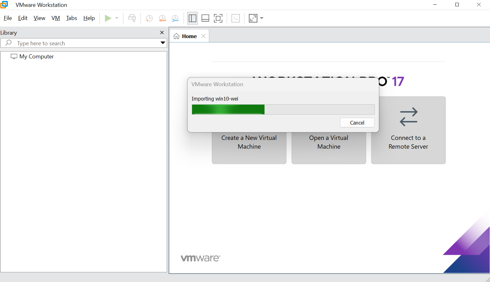
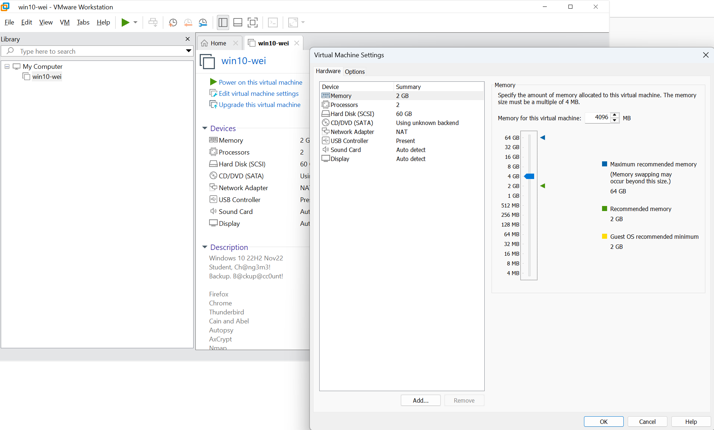
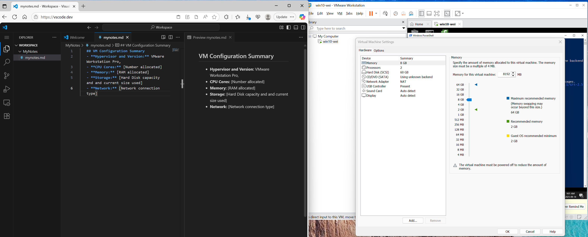
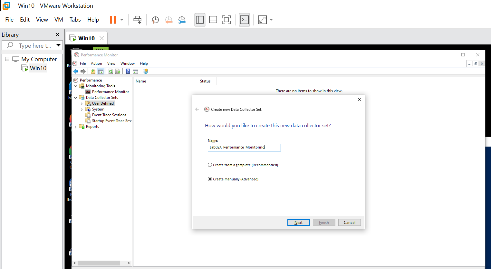
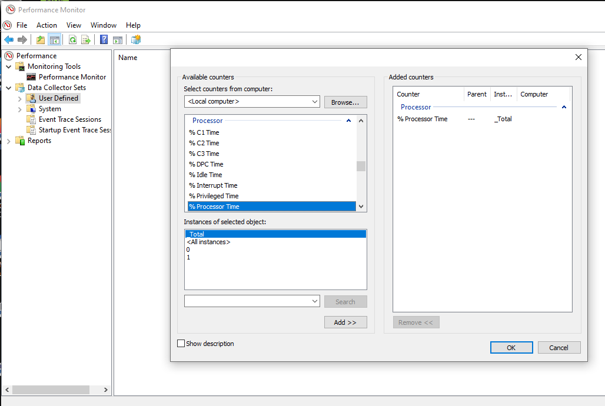
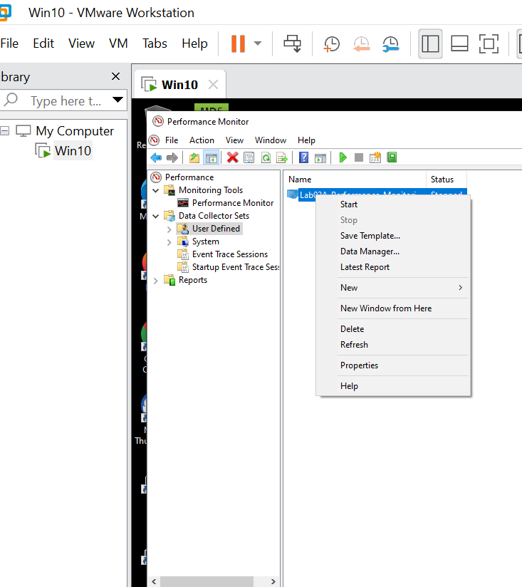
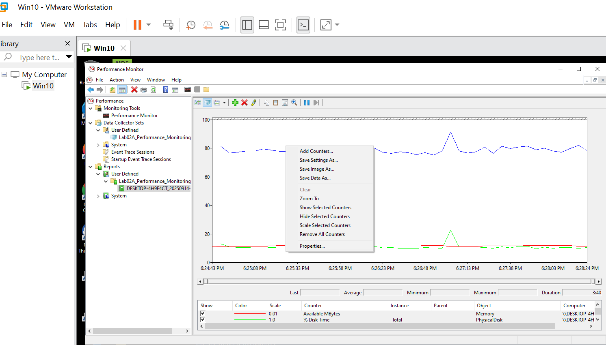

# 🖥️ Lab02A - Understanding CPU and Memory: Windows VM Analysis

**Course:** SPR101 - Introduction to Computer Systems and Security  
**Lab Number:** Lab02A  
**Weight:** 2% of final grade  
**Lab Session Duration:** 1 hour 45 minutes  
**Due Time:** 2026/01/29 (11:59 PM before the start of the next lab session)  
**Silence Period:** 24 Hours before Due Time. No email request for extension or questions will be answered in Silence Period. 

---

## 🎯 Learning Objectives

By the end of this lab, you will be able to:

1. **Set up and configure a Windows Virtual Machine** using VMware Workstation. 
2. **Analyze CPU specifications and performance** using Windows system tools
3. **Examine memory hierarchy** through practical exploration
4. **Understand basic idea ofperformance monitoring** and hypervisor management
5. **Document system specifications** and performance characteristics

---

## 📋 Pre-Lab Requirements

### Required Software
- **Bring your own external SSD drive** to the lab.
- **VMware Workstation Pro** (It is on the Security Lab computer, and if you are at home, you can use it for free as a student on your own computer -- `No, you don't need a license key!`)
- **Windows 10 VM Image** (Download from Security Lab: On your security lab computer, open `File Explorer` --> Click Address Bar --> `\\mydrive\courses\SPR100\Win10`)
- **Git for Windows** (for Lab submission)
- **Read submission guidelines** in the [readme.md](../readme.md) file of the Labs root directory (one level above from this Lab02A folder).

---

## 🚀 Lab Activities

### Part 1: Virtual Machine Setup and Configuration (45 minutes)

#### 1.1 Download and StartWindows VM

   - 1.	Open “File Explorer” on your lab computer (Press `Windows + E`), input the following address to the address bar:
`\\mydrive\courses\SPR100`
   - 2. Find Windows 10 VM folder `Win10` and download it to your own SSD hard drive.
   - 3. Open VMware Workstation Pro and import the Windows VM file:
      - On VMWare Workstation Pro, click on `File` → `Open` → `Virtual Machine` → and select the Windows VM file (`win_nov22.ova`) you just downloaded to your external SSD drive.
      - In the `Import Virtual Machine` tab:
          - Name your new virtual machine as `win10-[your student username]` (e.g., if your student user name is `johndoe123`, name it `win10-johndoe123`). 
          - Select your `Storage path for the new virtual machine` by clicking `Browse` and select a folder of your own choice **on your external SSD drive** -- this will be your VM storage location.  Do not select the default location on your security lab computer! You will lose everything when you reboot the security lab computer!
          - Think: What is the difference between `win_nov22.ova` and your VM storage folder?
   - 4. Wait for importing the VM, it will take a few minutes. The window will look something like this: 
   
   - 5. Now your Windows 10 VM is imported to VMWare Workstation Pro, don't start it yet. Select your Windows 10 VM and click "`Edit virtual machine settings`". You can see the default memory is `2 GB` -- It is too small for Windows 10 so your VM experience will be super slow! We want to increase the `memory` to at least 4GB (I set mine to 8GB because I have a lot of memory on my host machine), do it like this:
   
   - 6. Click the VM and then click the green button "`Power on this virtual machine`" to start the VM. It will boot up and you will see the Windows 10 login screen. 
   - 7. Login. (Where is your password? -- Check the folder you downloaded the VM image!)

#### 1.2 VM Configuration Analysis
1. **Examine VM Settings and Documenting Them:**
   - In your VMWare Workstation Pro on your host PC: Click `VM` → `Settings`
   - Read the configurations in the `Hardware` tab.
   - Document the configuration on a text file as your note on your ***host PC**. 
       - Why is it important to document them on your host PC, ***NOT*** inside your VM?  -- A general rule of thumb is you never do logging and documentation inside your experiment environment, you may lose everything if your experiment environment is lost. Always make backup of your own notes on your host PC. 
       - Use this Markdown template to document your findings of the VM hardware configurations:     
   ```markdown
   ## VM Configuration Summary
   - **Hypervisor Name** [Default should be VMware Workstation Pro]
   - **Hypervisor Version:** [Version number]
   - **CPU Cores:** [Number of CPU cores allocated to this VM]
   - **Memory:** [Memory (RAM) allocated]
   - **Storage:** [Hard disk capacity and and current used hard disk size]
   - **Network:** [Network connection type]
   ```
   - This is what you are recommended to do for note taking:
      - You open a web browser on your host PC, and open https://vscode.dev/, open your local PC folder on your own external SSD drive, and start a new file with the name `mynotes.md`. 
      - You start taking notes in the web vscode while you are working on VMWare Workstation Pro.
      - The screenshot shows what it looks like:
      
      - Remember: Always take your notes and keep your notes on your host PC, store your notes on your own external SSD drive, ***NOT*** inside your VM. Because:
         - If your VM is corrupted, you will lose all your notes inside the VM.
         - If your host PC crashed, you will lose everything on your host PC.
         - Everything you saved on your external SSD drive is still safe when VM is lost or your host PC is crashed.
2. **Change your initial password of `Student` Account**
   - Do some search online (using Google, for example) to find out how to change your password for `Student` user on Windows 10, and change the initial password.
   - Take notes on how you changed the password on Windows 10.

### Part 2: Windows System Analysis (45 minutes)

#### 2.0 Install Git for Windows
In your VM:
- Press `Windows + R`, type `powershell`, press Enter
- Run the following command to install Git for Windows:
```powershell
winget install Git.Git
```
- Follow the prompted instructions to install Git for Windows. Make sure you ***read*** the prompt information.


#### 2.1 CPU Analysis
1. **System Information:**
   - Press `Windows + R`, type `msinfo32`, press Enter

   
   **Navigate to CPU Information:**
   - In the left pane, click on "`System Summary`" to see overall system info on the right pane.
   - Click on "`Processor`" in the left pane to see detailed CPU specifications
   - Document the following information in your own notes:
     - Processor name 
     - Number of cores and logical processors


2. **Task Manager CPU Analysis:**
   - Press `Ctrl + Shift + Esc` to open `Task Manager`
   - Click `More details`.
   - Go to Performance tab → CPU
   - Document:
     - Current CPU Utilization
     - Number of virtual processors
     - CPU Base Speed
     - CPU Current Speed
     - System Up Time (how long has this OS tarted)
   - We take notes, we don't take screenshots (or photos). 


#### 2.2 Memory Analysis
1. **Memory Specifications:**
   - **In System Information (`msinfo32` in previous steps):**
     1. In the left pane, find and click "`System Summary`"
     2. Find memory information in the right pane
     3. Document:
        - Total physical memory
        - Available physical memory
        - Total Virtual memory (What does this mean?)
        - Available Virtual memory  (What does this mean?)
   
2. **PowerShell Memory Commands:**
   - Start `powershell` by pressing `Win + R` and tyoe `powershell`. Run the following commands (lines starting with "#" are comments, they are not command you should run): 
   ```powershell
   # Get memory information
   Get-WmiObject -Class Win32_PhysicalMemory 
   ```
   - Document `__PATH` and `Capacity` from the commandline results.
   - Run the following command:
   ```powershell   
   # Get available memory
   Get-Counter "\Memory\Available MBytes"
   ```
   - Document the result with `Available memory in MBytes`.

#### 2.3 System Performance Monitoring
1. **Performance Monitor:**
   - Press `Windows + R`, type `perfmon`, press Enter. It will show a Performance Monitor window. 
   - **Create a new Data Collector Set:**
     1. In the left pane, expand "Data Collector Sets" by double-clicking on it.
     2. Right-click on "User Defined"
     3. Select "New" → "Data Collector Set"
     4. Enter a name: "Lab02A_Performance_Monitoring". Your window will look something like this:
     
     5. Select "Create manually (Advanced)" and click "Next"
     6. Check "Create data logs" → "Performance Counter" and click "Next"
     7. Click "Add" to add performance counters. For example, if you want to add `Processor: % Processor Time`, you need to select the `Processor` from `Available Counters` block, click `Processor` and click `%Processor Time`, then click the `Add >>` button to added the counter, it will look something like this: 
      
     8. Add these specific counters the same way as the previous step:
        - Processor: % Processor Time
        - Memory: Available MBytes  
        - Physical Disk: % Disk Time  
      And click "Next" after you have added all three counters above.      
     9.  Set sample interval to "5 seconds" and click "Next"
     10. Select a file location where you want to save the logs, recommend: Click `Browse` and select `C:\Users\Student\Documents`. and click "Next".
     11. Make sure it is Run as `<Default>`, and `Save and close` is select, then click "Finish".
   - **Start the Data Collector Set:**
     1. Right-click on your new Data Collector Set, it should show something like below:
      
     2. Click "`Start`"
     3. Wait for about 2 minutes to and click `Data Collector Sets`-> `User Defined`, right-click `Lab02A_Performance_Monitoring`and click "`Stop`".
     - **View Results:**
     1. In your “Performance Monitor” window, Navigate to "Reports" → "User Defined" → "Lab02A_Performance_Monitoring"
     2. Double-click on the report to view performance data
     3. Right-click on the report chart and select "Save as Image..." to save the report to your VM, it should look like this:
      
     4. Select your folder in your VM and name the image as "`performance_chart.gif`".
     5. Move the report out of the VM so from the host yu can copy the file to own laptop/SSD hard drive. You will need this `.gif` file for your report to submit. 
        - How do you copy a file out of VM? -- Do some research on your own. (hint: Can you make a shared folder in VMWare Workstation Pro? Do you have internet access in your VM?)


2. **Resource Monitor:**
   - Press `Windows + R`, type `resmon`, press Enter
   - Monitor real-time resource usage
   - Document peak usage during different activities:
     - CPU
     - Memory
     - Disk

## 📝 Documentation and Lab Report Requirements

### Required Template

Create a comprehensive lab report using the following template structure:

```markdown
# Lab02A - Windows VM CPU and Memory Analysis Report

**Student Name:** [Your Full Name]  
**Student ID:** [Your Student ID]  
**Course Section:** [Your Section Number]  
**Completion Date:** [YYYY-MM-DD]  
**Lab Duration:** [Actual time taken]

---

## Part 1: Virtual Machine Setup and Configuration

### 1.1 VM Configuration Summary
- **Hypervisor Name:** [VMware Workstation Pro]
- **Hypervisor Version:** [Version number]
- **CPU Cores:** [Number of CPU cores allocated to this VM]
- **Memory:** [Memory (RAM) allocated]
- **Storage:** [Hard disk capacity and current used hard disk size]
- **Network:** [Network connection type]

### 1.2 VM Import and Startup Process
- **VM File Source:** [\\mydrive\courses\SPR100\Win10]
- **Import Method:** [Describe how you imported win_nov22.ova]
- **VM Name:** [win10-[your username]]
- **Storage Path:** [Path on your external SSD drive]
- **Startup Time:** [Time from power-on to login screen]

### 1.3 Initial System Configuration
- **Password Change Process:** [Describe how you changed the Student account password]
- **Git Installation:** [Describe the Git for Windows installation process using winget]

---

## Part 2: Windows System Analysis

### 2.1 CPU Analysis Results

#### System Information (msinfo32)
- **Processor Name:** [Full processor name from System Summary]
- **Number of Cores:** [Physical cores from Processor section]
- **Logical Processors:** [Total logical processors from Processor section]

#### Task Manager CPU Analysis
- **Current CPU Utilization:** [Percentage from Performance tab]
- **Number of Virtual Processors:** [Count from Task Manager]
- **CPU Base Speed:** [Base speed from Task Manager]
- **CPU Current Speed:** [Current operating speed from Task Manager]
- **System Up Time:** [How long the OS has been running]
- **CPU Utilization Observations:** [Describe what you observed during monitoring]

### 2.2 Memory Analysis Results

#### System Information Memory Details
- **Total Physical Memory:** [Amount from msinfo32 System Summary]
- **Available Physical Memory:** [Amount from msinfo32 System Summary]
- **Total Virtual Memory:** [Amount from msinfo32 System Summary]
- **Available Virtual Memory:** [Amount from msinfo32 System Summary]
- **Virtual Memory Explanation:** [Explain what Total and Available Virtual Memory means in your own words]

#### PowerShell Memory Commands Output
**Physical Memory Information:**[Paste the output of: Get-WmiObject -Class Win32_PhysicalMemory]

- **Document:** __PATH and Capacity values from the output

**Available Memory Information:**
[Paste the output of: Get-Counter "\Memory\Available MBytes"]
- **Available Memory:** [Document the Available MBytes value]

### 2.3 System Performance Monitoring Results

#### Performance Monitor Data Collector Set
- **Data Collector Set Name:** Lab02A_Performance_Monitoring
- **Sample Interval:** 5 seconds
- **Duration:** [Recorded duration of the monitoring]
- **Counters Monitored:**
  - Processor: % Processor Time
  - Memory: Available MBytes
  - Physical Disk: % Disk Time
- **Log Location:** [C:\Users\Student\Documents or your chosen location]

#### Performance Data Summary
- **CPU Usage Range:** [Minimum - Maximum % during 2-minute monitoring]
- **Memory Available Range:** [Minimum - Maximum MB during monitoring]
- **Disk Usage Range:** [Minimum - Maximum % during monitoring]
- **Performance Patterns Observed:** [Describe any patterns, spikes, or notable changes]

#### Resource Monitor Observations
- **Peak CPU Usage:** [Highest observed percentage from resmon]
- **Peak Memory Usage:** [Highest observed usage from resmon]
- **Resource Usage During Activities:** [Describe what happened when you performed different tasks while monitoring]

#### Performance Monitor Data Collector Graph
[Put your `performance_chart.gif` image here]
- **How You Extracted:** [Describe how you moved the file from VM to host]

---

## Analysis and Conclusions

### Key Findings
1. **VM Configuration:** [Summarize your VM setup experience and final configuration]
2. **CPU Performance:** [Summarize what you learned about the CPU specifications and performance]
3. **Memory Management:** [Summarize memory analysis findings and understanding of virtual vs physical memory]
4. **Performance Monitoring:** [Summarize insights from performance monitoring tools]

### Technical Insights
- **System Architecture Understanding:** [What did you learn about CPU cores, logical processors, and memory hierarchy?]
- **Virtualization Concepts:** [What did you learn about VM configuration and resource allocation?]
- **Performance Monitoring Tools:** [What did you learn about Windows performance monitoring capabilities?]
- **PowerShell Commands:** [What did you learn about using PowerShell for system analysis?]

### Challenges and Solutions
- **VM Setup Challenges:** [Any difficulties with VM import, configuration, or resource allocation]
- **Performance Monitoring Issues:** [Any problems with data collector sets or performance tools]
- **File Transfer Challenges:** [How did you solve moving files between VM and host?]
- **Solutions Applied:** [How did you resolve any challenges encountered?]
- **Lessons Learned:** [What would you do differently next time?]

### Understanding Questions
- **Virtual Memory Concept:** [Explain in your own words what virtual memory is and why it's important]
- **VM Resource Allocation:** [Explain how VM resource allocation affects performance]
- **Performance Monitoring Value:** [Explain why performance monitoring is important in system administration]

---

**Report Completion Time:** [Total time spent on lab]  
**Confidence Level:** [Rate your understanding 1-10]  
```

### Documentation Submission Checklist

Before submitting, ensure you have:

- [ ] **VM Configuration Summary** with hypervisor details, CPU, memory, and storage specifications
- [ ] **VM Setup Process Documentation** including import method, naming, and startup time
- [ ] **Initial Configuration Details** for password change and Git installation
- [ ] **CPU Analysis Data** from both msinfo32 and Task Manager with all required specifications
- [ ] **Memory Analysis Results** from System Information and PowerShell commands with outputs
- [ ] **Performance Monitoring Data** including Data Collector Set results and Resource Monitor observations
- [ ] **Performance Chart Image** (performance_chart.gif) properly extracted from VM
- [ ] **Technical Analysis** with key findings, insights, and understanding demonstrations
- [ ] **Challenges Documentation** with problems faced and solutions applied
- [ ] **Professional Formatting** with proper markdown structure and complete data

### Important Notes

- **Use actual data:** Replace all placeholder text with your real findings from the lab. In your submission, there shouldn't be any placeholder text like `[Put this and that here]` or `[Put your image here]`. 
- **Include command outputs:** Paste actual PowerShell command results, not examples
- **Be specific:** Include exact numbers, percentages, and measurements you observed
- **Explain concepts:** Define virtual memory, VM resource allocation, and monitoring concepts in your own words
- **Show understanding:** Demonstrate comprehension through analysis and conclusions sections

---


## 📤 Submission Instructions

**Important: Read submission guidelines** in the [readme.md](../readme.md) file of the Labs root directory (one level above from this Lab02A folder).

### What to Submit
1. **Complete Lab02A folder** with all required files
2. **`README.md`** with comprehensive lab report using the provided template
3. **Images folder** containing `performance_chart.gif` or any other images you want to submit, all images should be properly added to your `README.md` file and they should be readable in your `README.md` file.


### Submission Process
0. Make sure your `lab folder` is up-to-date.
- Your `lab folder` is a local clone of your GitHub lab repository: `SPR100_Labs`, that you previously cloned from GitHub, or initialized with `git init`.
- You can either put your lab folder inside your own Windows VM, or on your Host PC.
- Make sure you always back up your lab folder.

- Use the following two commands to make sure your `lab folder` is up-to-date:
```cmd
git pull
git status
```
(Think: why do you have to do `git pull`? What does `git status` do?)

- If you don't have your `lab folder` anywhere, check Lab01A or Lab01B for instructions, and clone the one you created from GitHub:
```cmd
git clone [Your Lab Repository URL]
```


1. Navigate to your lab folder:
   ```cmd
   cd [YOUR_PATH_CONTAINING_LAB_FOLDER]\SPR100_Labs\
   mkdir -p Lab02A\
   ```
2. Put all required files into your Lab02A folder.

3. Add all files to your local Git repository:
   ```cmd
   git add .
   ```

3. Commit with descriptive message:
   ```cmd
   git commit -am "Complete Lab02A - Windows VM CPU and Memory Analysis"
   ```

4. Push to GitHub remote:
   ```cmd
   git push
   ```

---

